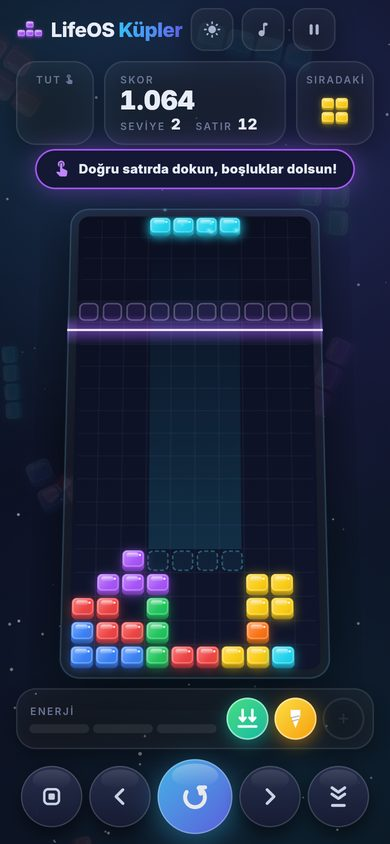
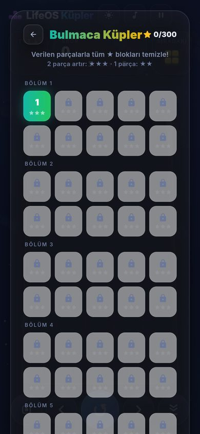

<p align="center">
  
</p>

<h1 align="center">LifeOS Küpler</h1>

<p align="center">
  Düşen blokları dizip satırları patlattığın, bol efektli 2.5D blok bulmaca oyunu.<br>
  Android · iOS · Windows · Linux · macOS · Web
</p>

<p align="center">
  <a href="https://github.com/07erkanoz/LifeOsTetris/actions/workflows/build.yml"></a>
</p>

---

## İndir ve dene

| Platform | Dosya |
|---|---|
| Android (modern telefonlar, küçük) | [LifeOS-Kupler-arm64.apk](https://github.com/07erkanoz/LifeOsTetris/releases/download/test-build/LifeOS-Kupler-arm64.apk) |
| Android (tüm telefonlar) | [LifeOS-Kupler.apk](https://github.com/07erkanoz/LifeOsTetris/releases/download/test-build/LifeOS-Kupler.apk) |
| Windows | [LifeOS-Kupler-Windows.zip](https://github.com/07erkanoz/LifeOsTetris/releases/download/test-build/LifeOS-Kupler-Windows.zip) |

- **Android:** Linki telefonun tarayıcısında aç ve inen APK'yı kur. "Bilinmeyen kaynaklardan
  yükleme" izni istenebilir.
- **Windows:** Zip'i bir klasöre çıkar ve `lifeos_kupler.exe` dosyasını çalıştır. SmartScreen
  uyarırsa *Ek bilgi → Yine de çalıştır* de.
  Zip şifreli değildir. Windows çıkartırken şifre sorarsa zip'e sağ tıkla,
  *Özellikler → Engellemeyi kaldır* kutusunu işaretle ve tekrar *Tümünü ayıkla* de
  (ya da 7-Zip ile aç).

Bunlar test derlemeleridir ve `main` dalına yapılan her gönderimde otomatik olarak
yenilenir ([Releases → Test sürümü](https://github.com/07erkanoz/LifeOsTetris/releases/tag/test-build)).

## Ekran görüntüleri

| Menü | Dörtlü silme | Süper Küpler: bomba |
|:---:|:---:|:---:|
|  |  |  |

| Hayalet Çizgi | Bulmaca Küpler | Bulmaca seçimi |
|:---:|:---:|:---:|
|  |  |  |

<p align="center"></p>

## Oyun modları

### ✨ Süper Küpler
Satır sildikçe **enerji barı** dolar: 3 satır 1 güç verir, dörtlü silme barı anında doldurur.
En fazla 3 güç birikir. Gücü kullanmak için yuvasına dokun ya da **1 · 2 · 3** tuşlarına bas.

| Güç | Etkisi |
|---|---|
| 💣 Bomba | Düştüğü yerde 3×3 alanı patlatır (hedef alanı önceden gösterilir) |
| ▪️ Tekli blok | Tek karelik parça; kapanmış delikleri doldurur |
| 🔩 Matkap | Blokların içinden geçer, bütün sütunu yer |
| 🧲 Yerçekimi | Havada kalan bloklar düşer, dolan satırlar silinir |
| ⏳ Ağır çekim | 10 saniye boyunca her şey yavaşlar |
| 👻 Hayalet Çizgi | Yığının içinden süzülür; dokununca bulunduğu satırın boşluklarını doldurur |

### 🧩 Bulmaca Küpler
10 bölümde **100 bulmaca**. Tahtada altın ★ bloklar var; sadece verilen parçalarla
hepsini temizlemen gerekiyor. Parçalar kendiliğinden düşmez, istediğin kadar düşün.

- Her seviye her açılışta **yeni, rastgele bir tahta** üretir. Zorluk (parça, satır ve ★
  sayısı) seviye numarasına göre artar.
- Üretilen her tahta, oyuncuya gösterilmeden önce oyun motorunda oynatılır ve
  **çözülebilir olduğu doğrulanır**.
- 2 parça artırırsan ★★★, 1 parça artırırsan ★★, hiç artırmazsan ★ alırsın.
  Çözdükçe sıradaki bulmaca açılır.

### 🎮 Klasik Küpler
- **Normal:** Hız 10. seviyeye kadar yavaşça artar, sonra sabit kalır.
- **Rahat:** Sabit, sakin hız; oyun sonsuza kadar sürer.

Her modun rekoru ayrı tutulur.

## Özellikler

- **Görünüm:** 2.5D "jelibon" bloklar, koyu ve açık tema, telefon ve masaüstü için ayrı
  yerleşim. Tahta her ekrana tam oturur.
- **Efektler:** Parçacık patlamaları, ekran sarsıntısı, sert düşüş izleri, şok dalgaları,
  satır çökme ve seviye atlama animasyonları, "ÇİFT! / DÖRTLÜ! / KOMBO ×2" yazıları,
  hareketli arka plan.
- **Motivasyon yazıları:** Puan ve satır hedefleri, rekor kırma, ilk dörtlü, kombo serileri,
  kıl payı kurtuluşlar ve ara sıra övgüler.
- **Ses:** Oyuna özel üretilmiş efekt sesleri; rastgele sırayla çalan müzik listesi.
- **Dil:** Türkçe ve İngilizce. İlk açılışta cihaz diline göre seçilir.
- **Ayarlar:** Ekran butonlarını gizleme ve saydamlıklarını ayarlama, titreşim, ekran sarsıntısı,
  görsel efektler, müzik ve efekt sesi.
- **Oyun kuralları:** Tutma, hayalet parça, 7'li torba, SRS döndürme, T-spin, kombo, B2B,
  mükemmel temizlik.

## Kontroller

| Klavye | Dokunmatik | Eylem |
|---|---|---|
| ← → | Yatay kaydır / butonlar | Taşı |
| ↑ veya X | Tahtaya dokun | Döndür |
| Z | – | Ters döndür |
| ↓ | Aşağı kaydır | Yumuşak düşüş |
| Space | Aşağı fırlat / ⇊ butonu | Sert düşüş |
| C | TUT kartına dokun / yukarı fırlat | Tut |
| P, Esc | ⏸ | Duraklat |
| 1 · 2 · 3 | Güç yuvasına dokun | Gücü kullan (Süper Küpler) |

## Geliştirme

```bash
flutter pub get
flutter test                 # oyun kuralları, güçler, 100 bulmaca, arayüz testleri
flutter run                  # bağlı cihaz veya masaüstü
flutter build apk --release  # Android
```

| Komut | Ne yapar |
|---|---|
| `python3 tool/generate_sfx.py` | Efekt seslerini yeniden üretir (numpy gerekir) |
| `dart run flutter_launcher_icons` | `assets/icon/` içindeki kaynaktan tüm platform ikonlarını üretir |
| `--dart-define=KUPLER_DEMO=true` | Oyunu neredeyse dolu tahtayla başlatır (efekt demosu) |
| `--dart-define=KUPLER_DEMO_SUPER=true` | Süper Küpler'i güç yuvaları dolu başlatır |
| `--dart-define=KUPLER_DEMO_PUZZLE=<n>` | Enter'a basınca n. bulmacayı açar |
| `--dart-define=KUPLER_DEMO_LEVELS=true` | Oyunu bulmaca seçim ekranında açar |

### Proje yapısı

```
lib/core/      Saf oyun mantığı: kurallar, güçler, bulmaca üretici (Flutter'dan bağımsız)
lib/game/      Kontrolcü, efekt motoru, motivasyon, çizim (sprite'lar, tahta, arka plan)
lib/audio/     Efekt sesleri, müzik listesi, titreşim
lib/ui/        Ekranlar ve bileşenler (oyun, menüler, güç barı, Hakkında)
lib/l10n/      Türkçe / İngilizce metinler
lib/theme/     Koyu / açık renk paleti
assets/        Yazı tipi, sesler, müzikler, ikon kaynağı
tool/          Ses üretici
```

## Üçüncü taraf içerikler

- **Inter yazı tipi:** SIL Open Font License 1.1 ([assets/fonts/OFL.txt](assets/fonts/OFL.txt)).
- **Müzikler:** Pixabay ve Free To Use (freetouse.com) parçaları; kendi lisanslarına tabidir
  ([assets/audio/music/CREDITS.md](assets/audio/music/CREDITS.md)).
- **Ses efektleri ve ikon:** Bu proje için üretildi.

## Lisans

Kod, ses efektleri ve ikon [MIT lisansı](LICENSE) ile dağıtılır. Müzikler ve yazı tipi
kendi lisanslarına tabidir ve MIT kapsamında değildir.

## Geliştirici

**Erkan ÖZ** · [erkanoz.com](https://erkanoz.com) · LifeOS ailesinin bir parçası:
[lifeos.com.tr](https://lifeos.com.tr)
